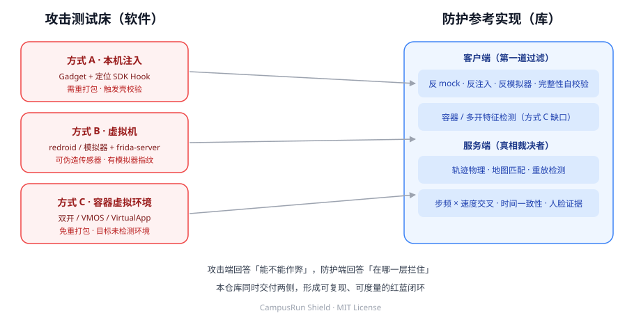

# CampusRun Shield · 校园跑安全盾


**校园跑类运动打卡应用的红蓝对抗开源工具集：三种攻击测试床 + 分层防护参考实现**

> 案例目标：**华中大体育**（`net.crigh.hzkjsport` v1.1.0，青果体育平台 / 华中科技大学校园跑）
> 参赛定位：2026 华中科技大学优秀开源项目征集 · 原创开源软件项目赛道 · 工具软件

<p align="center">
  
</p>

---

## 目录

- [为什么做这个项目](#为什么做这个项目)
- [三种攻击方式](#三种攻击方式)
- [防护蓝图](#防护蓝图)
- [两件交付物](#两件交付物)
- [快速开始](#快速开始)
- [评估结论](#评估结论)
- [目录结构](#目录结构)
- [文档索引](#文档索引)
- [使用边界](#使用边界)
- [许可](#许可)

## 为什么做这个项目

校园跑/运动打卡类 App 把跑步成绩与学分直接挂钩，天然是作弊对抗的前线：定位可以用虚拟环境伪造、
轨迹可以用脚本播放、步频可以伪造、人脸核验可以尝试绕过。另一方面，厂商的防护长期是"黑盒"——
学生只能靠零散教程试错，学校难以评估自家 App 的真实防护水位。

本项目把攻防两侧都做成 **开源、可复现、可度量** 的工程：

- **攻击端（软件）**：三种攻击测试床，覆盖当前主流的作弊技术路线
- **防护端（库）**：以华中大体育为真实案例，给出客户端 + 服务端分层防护与可运行参考实现
- **评估端**：攻击向量 × 检测手段的对抗矩阵，用实测数据说明"哪一层守得住"

## 三种攻击方式

| # | 方式 | 做法 | 为什么能成 | 对应解法 |
|---|---|---|---|---|
| A | **本机注入重打包** | 改 APK 塞 Frida Gadget，在定位 SDK 层替换轨迹 | 一台真机即可 | 壳的 `classes.dex` 完整性校验**已挡住**（实测 tamper）；再补签名/CRC 自校验 + 注入特征检测 + native 指标签名 |
| B | **虚拟机 + 虚拟环境** | 模拟器/redroid + root + frida-server + 传感器伪造 | 不改 APK，不触发 dex 校验；步频也能伪造 | 模拟器/VM 指纹 + 设备认证 + 传感器×GPS 交叉 + 时间一致性 + 群体聚类 |
| C | **容器虚拟环境** | 双开 / VMOS / VirtualApp 里运行，容器内 hook | **不用改包、不用 root，目标也没做运行环境检测**——最弱一环 | 容器特征（进程路径/类名/多开）+ 安装来源与签名链 + 环境指纹一致性 |

一句话排序：**C 最弱（客户端不做环境校验的锅）→ A 中等（壳挡了一半）→ B 最难被业务层识破，但最容易被环境指纹抓住。**

## 防护蓝图

| 层 | 内容 | 参考实现 |
|---|---|---|
| 0 设备与环境 | 反 mock / 反注入 / 反模拟器 / 容器多开检测 / 签名与 CRC 自校验 | `defense/client-side/IntegrityGuard.kt` 等 |
| 1 采集加固 | 关键指标 native 计算 + HMAC 结果签名 | `defense/client-side/native/metric_guard.cpp` |
| 2 上报通道 | 签名 + nonce + 时间窗 + 证书绑定 | `docs/04-defense-blueprint.md` |
| 3 数据真实性 | 轨迹物理、地图匹配、步频×步长交叉、环境一致性 | `defense/server-side/*.py` |
| 4 群体行为 | 轨迹指纹哈希、DTW 相似度、同设备多账号 | `defense/server-side/trajectory_plausibility.py` |
| 5 证据链处置 | 心跳 + 随机抽查 + 人脸活体 + 阶梯处罚 | `docs/04-defense-blueprint.md` |

## 两件交付物

| 交付物 | 形态 | 位置 |
|---|---|---|
| **攻击测试床（软件）** | 可执行 CLI + Frida 脚本 + 环境编排 | `offense/` |
| **防护参考实现（库）** | 服务端校验器 + 客户端检测模块 + 校验入口（不是独立 App） | `defense/` |

## 快速开始

```bash
# 攻击端：生成轨迹 → 推送脚本与轨迹 → 附加目标进程（frida-server 环境）
python offense/campusrun-attacker.py route --shape stadium --center 30.5142,114.4049 \
    --track-length 100 --radius 18 -o campusrun_route.json
python offense/campusrun-attacker.py push --route campusrun_route.json --debug
python offense/campusrun-attacker.py attach

# 防护端：统一校验入口（demo / 轨迹 / 证据）
python defense/validate_cli.py demo
python defense/validate_cli.py trajectory campusrun_route.json
python defense/validate_cli.py evidence evidence.json

# 方式二：起一套容器安卓（详见 offense/vm/README.md）
docker compose -f offense/vm/docker-compose.yml up -d
```

## 评估结论

- 客户端单点检测（isMock、包名黑名单）可被方式一/三绕过 → 只能当过滤器
- 壳的 dex 完整性校验是实测有效的第一道硬门槛（方式 A 需要额外成本才能绕过）
- **服务端交叉校验是决定性防线**：方式一无法伪造步频 → 步频×速度必露馅
- **方式 C 之所以能成，是目标应用缺少运行环境检测**——补这一层成本最低、收益最大
- 人脸活体是三种方式共同的硬边界

详见 [docs/05-evaluation.md](docs/05-evaluation.md)。

## 目录结构

```
campusrun-shield/
├── docs/                     # 威胁模型 / 三种攻击方式 / 防护蓝图 / 评估矩阵 / 路线图 / 开源结构
│   └── assets/architecture.svg
├── offense/                  # 攻击端软件
│   ├── campusrun-attacker.py #   CLI：info / route / push / attach / repack
│   ├── ondevice/             #   方式 A：Gadget 注入 + 定位虚拟层
│   ├── vm/                   #   方式 B：redroid / 模拟器 + frida-server + 传感器伪造
│   └── container/            #   方式 C：双开 / VMOS / VirtualApp 容器
├── defense/                  # 防护参考实现（库）
│   ├── validate_cli.py       #   统一校验入口：demo / trajectory / evidence
│   ├── server-side/          #   轨迹合理性、成绩证据校验
│   └── client-side/          #   反 mock / 反模拟器 / 完整性自校验 / native 指标签名
├── submission/               # 参赛佐证材料（docx 生成脚本）
├── .github/                  # CI、Issue/PR 模板
├── CHANGELOG.md
├── LICENSE (MIT)
└── README.md
```

## 文档索引

| 文档 | 内容 |
|---|---|
| [01 威胁模型](docs/01-threat-model.md) | 资产、攻击者画像、攻击面、STRIDE |
| [02 方式 A](docs/02-offense-method-a.md) | 本机注入重打包的攻击链与边界 |
| [03 方式 B](docs/03-offense-method-b.md) | 虚拟机 + 本地虚拟环境 |
| [03b 方式 C](docs/03b-offense-method-c.md) | 容器虚拟环境与"环境检测缺失"根因 |
| [04 防护蓝图](docs/04-defense-blueprint.md) | 五层纵深防护设计 |
| [05 对抗评估](docs/05-evaluation.md) | 攻击向量 × 防护有效性矩阵 |
| [06 路线图](docs/06-roadmap.md) | 里程碑与参赛申报 |
| [07 开源结构](docs/07-repo-structure.md) | 两件交付物的组织方式 |

## 使用边界

本项目面向**授权安全评估、自建测试环境与教学研究**。攻击端代码用于在你自己控制的设备/虚拟环境上
验证防护有效性；请勿用于对他人账户或生产系统进行未授权操作。

## 许可

[MIT License](LICENSE) · 欢迎 issue / PR，见 [CONTRIBUTING.md](CONTRIBUTING.md) 与 [CHANGELOG.md](CHANGELOG.md)。

---

## 写在最后：校园跑，应该跑向更大的世界

我觉得校园跑确实是一个很好的途径，提升大学生身体素质，但是我觉得校园跑的形式太过单一了，如果只是在校内跑步、校内游泳、校内健身，而不是更多的校外活动，那反而是限定了学生的自由。我们需要的是校外，比如说走个一两万步作为记录。在下午还有自己的生活，自己游泳啊，自己健身，或者自己去打球，或者说自己去进行一些活动，都可以作为校园跑。而且我觉得这个东西要一一申请，如果说有这个东西，我觉得也不应该一一申请，学校应该自己搞一个一键识别的 AI，看你提交的资料合不合理，当然也可以有老师自己来管，然后就登记上去。这样更自动化也更好，也更符合学生。

**如果是一个技术、一个软件是用来卡学生的，那么学生同样可以造出一大堆东西来卡技术，所有的技术一定要是服务于社会的。**

